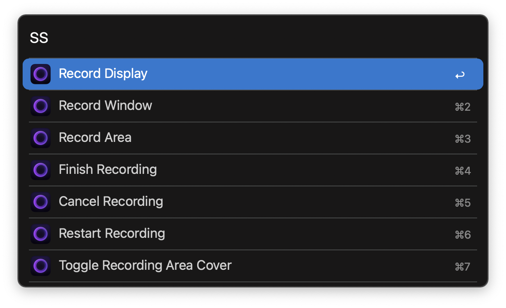

#  Screen Studio Alfred Workflow

Control [Screen Studio](https://screen.studio) with Alfred

[⤓ Download the workflow](https://github.com/iAli/screen-studio-workflow/releases/latest)

## Usage

Trigger Screen Studio commands via the `ss` keyword.

